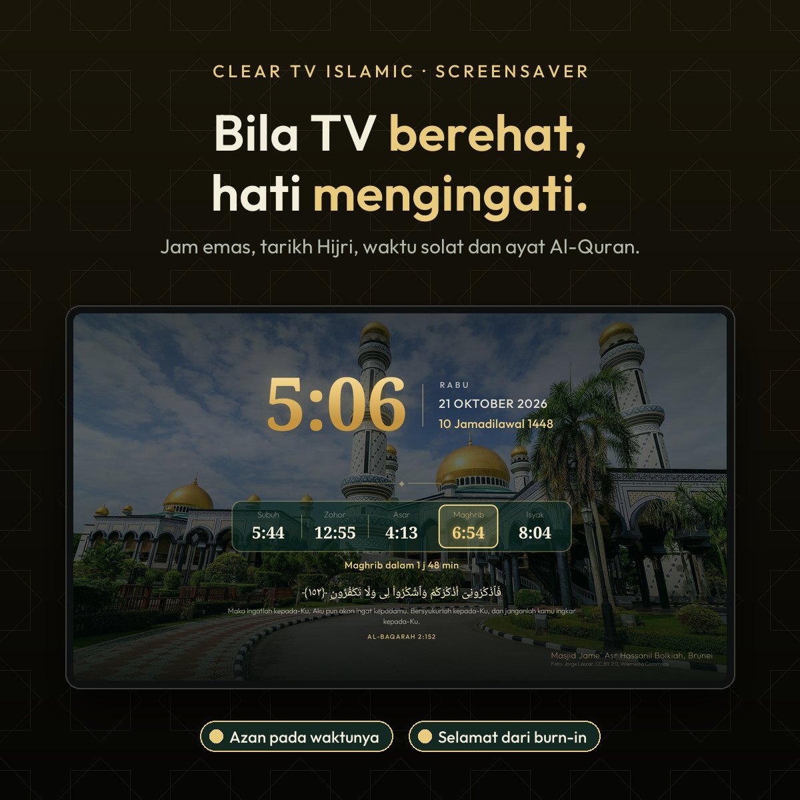

# Glass TV Islamik

**Android TV atau Google TV anda, laju dan tanpa iklan, dengan waktu solat JAKIM, azan pada setiap waktu,
ayat Al-Quran dan gambar masjid-masjid indah di dunia, termasuk Mekah dan Madinah.**

Glass TV Islamik membuang aplikasi bloat dan iklan dari TV melalui Wi-Fi, tanpa root dan semuanya boleh
dibatalkan, lalu menggantikan skrin utama yang penuh iklan dengan skrin kaca yang ringan. Di belakang aplikasi
anda: Masjidil Haram, Masjid Nabawi, Masjid Kristal dan banyak lagi. Di bawah jam: lima waktu solat hari ini.
Bila TV berehat: jam emas, tarikh Hijri dan ayat Al-Quran. Bila masuk waktu: azan.

<p>
  
  
  
</p>

- **Waktu solat JAKIM** untuk zon anda di bawah jam, dengan tarikh Hijri dan kiraan masa ke waktu seterusnya.
- **Azan** pada setiap waktu solat: skrin azan dan suara azan pilihan anda (azan Subuh boleh berlainan).
- **Screensaver Islamik**: jam emas, kad waktu solat dan ayat Al-Quran yang bergilir.
- **Gambar masjid** di belakang Home dan screensaver: Mekah, Madinah, Terengganu, Putrajaya, Istanbul, Brunei...
- **Ringan dan bersih**: iklan, penjejakan dan aplikasi bloat dimatikan; cache dibersihkan sendiri setiap 15 hari.

Cara memasang dan memilih zon JAKIM: lihat [Waktu solat dan azan](#waktu-solat-dan-azan) dan
[Setting it up](#setting-it-up). Dibina di atas [Glass TV oleh cocombee](https://github.com/cocombee/glass-tv)
(MIT); semua ciri asalnya kekal dan diterangkan dalam bahasa Inggeris di bawah.

<sub>Gambar promo menggunakan foto dari Wikimedia Commons: Masjid Quba (Muhammad Mahdi Karim, GFDL 1.2),
Masjidil Haram (Saudipics.com, CC BY-SA 4.0) dan Masjid Jame' Asr Hassanil Bolkiah (Jorge Láscar, CC BY 2.0).</sub>

## What you get

- **Keeps itself clean.** Every 15 days, while Home sits idle, the TV clears its app caches, where the Play
  Store leaves gigabytes of download leftovers that can make apps open to a blank screen. No computer needed,
  sign-ins and app data are never touched; the TV asks once to allow it.
- **Glass, like Apple's.** The dock's tray, the top-bar buttons and the menus show the picture behind them
  softened, with a shine along their edges. Android 10 has no live blur, so the picture is blurred once each
  time it changes and the glass draws its patch of it.
- **One selection that glides.** Between apps it is a pane of glass with the app's shadow under it; on the top
  bar and in the menus it is dark. It glides and changes shape from one to the next, never jumps.
- **Places to visit that renew themselves.** Once a week the TV takes the pictures Bing has shown on its home
  page over the past days — landmarks, landscapes, wildlife — deletes last week's and rotates through them,
  dimmed so the clock and tiles stay readable. The shelf above the dock names each one, its country and a few
  lines about it. Pictures with people in them are skipped: by the words in their caption, and by Android's
  own face detector on the TV. No key, no account, nothing to set up.
- **Every app tints the room.** The glow behind Home, and the glass with it, blends to the colour of whichever
  app is selected.
- **Arrange your apps from the remote.** Hold OK on an app for a glass menu with **Move** and **App info**.
  Move picks the app up: it wiggles, the arrows carry it (into or out of the dock too) and the other apps
  slide aside; OK puts it down. The order is kept, and apps installed later join at the end.
- **An Inputs menu in glass.** The selection glides out of the Inputs button into the list of HDMI and AV
  inputs, and Up from the top of the list glides it back.
- **Comes back as you left it.** Back from an app, the app you left is still selected; pressing Home on Home
  goes to the first app. When Android has closed Home to free memory, it comes back whole in one frame,
  with no black screen and no half-built dock.
- **A clock screensaver.** A grey analog dial with a yellow-orange second hand that ticks, the time and
  date beneath, drifting a little each minute so nothing burns in.
- **Rows feather out under the top bar** instead of being cut off when you scroll, and the Wi-Fi / Ethernet
  button can be hidden (`show_network_pill`).
- **Rotating wallpapers of your own** instead, with `"places": false`: put pictures in a theme's `wallpapers/`
  folder and choose how often they change, down to every 5 seconds. Each picture is decoded in the background
  and cross-faded.

| | |
|---|---|
|  |  |
| *Home, dengan masjid dan waktu solat* | *Semua aplikasi, pudar di bawah bar atas* |
|  |  |
| *Inputs, dalam kaca* | *Screensaver Islamik* |
|  | |
| *Skrin azan pada waktu solat* | |

Still light: on a Xiaomi Mi TV with 1.8 GB of RAM the launcher uses about 80–100 MB and stays there over hours
of use, one wallpaper is in memory at a time, the week's places take about 2 MB of storage, and nothing runs
while you are inside an app.

## Setting it up

**Using an AI coding agent** (Claude Code, Codex, Cursor, Copilot…)? Point it at this repository and ask it to
set up your TV. [AGENTS.md](AGENTS.md) tells any agent, even a small model, how to do it safely on any Android TV or Google
TV: it first works out which Glass TV your TV can run (the Android launcher, the LG webOS app, or neither on
Samsung and Roku), then
asks before each change, backs up first, never uninstalls, and checks each step with you as it goes.

The full step-by-step guide for debloating and installing is in
[docs/CLEANYOURTV-README.md](docs/CLEANYOURTV-README.md), and [PROMPT.md](PROMPT.md) lets a coding assistant do
it for you. In short:

```bash
python3 -m venv tools/venv && tools/venv/bin/pip install -r tools/requirements.txt
export TV_HOST=192.168.1.50                                   # your TV's IP address
tools/disable.sh examples/<your tv>/debloat.txt               # debloat
launcher/build-and-install.sh                                 # build the launcher and make it Home
tools/theme.sh themes/<your theme>                            # push your settings and wallpapers
```

Glass TV clears the TV's caches by itself every 15 days ([how](docs/cache-clean.md)). To clean several TVs
from one computer instead, [`tools/cache-clean.sh`](docs/cache-clean.md) finds the TVs on your network and
clears their caches, leaving sign-ins and app data untouched.

## Waktu solat dan azan


- **Waktu solat di Home:** satu baris kaca di bawah jam dengan tarikh Hijri, lima waktu solat hari ini
  (Subuh, Zohor, Asar, Maghrib, Isyak), waktu seterusnya ditonjolkan dan kiraan masa ("Asar dalam 12 min").
  Waktu setahun diambil sekali dari [e-Solat JAKIM](https://www.e-solat.gov.my) dan disimpan dalam TV.
- **Screensaver Islamik:** jam, tarikh Melayu dan Hijri, waktu solat (waktu seterusnya berwarna emas) dan
  satu ayat Al-Quran dengan terjemahan yang bertukar setiap 3 minit, atas corak bintang lapan penjuru yang
  bergerak perlahan supaya skrin tidak terbakar. Teks Arab Uthmani dan terjemahan Kementerian Agama RI,
  melalui quran.com (`launcher/app/src/main/res/raw/ayat.json`).
- **Gambar masjid:** di belakang screensaver, gambar Masjidil Haram, Kaabah, Masjid Nabawi, Masjid Quba dan
  masjid-masjid indah lain (Masjid Kristal, Masjid Putra, Istanbul, Brunei, Lahore, Baitulmaqdis...) bertukar
  bersama ayat, dengan nama masjid dan kredit jurugambar di penjuru. Semua dari Wikimedia Commons dengan lesen
  bebas; senarainya di [themes/islamik/masjid.json](themes/islamik/masjid.json). Muat turun ke folder theme
  anda dengan `python3 tools/masjid-photos.py <folder theme>`.
  Gambar yang sama juga menjadi latar Home, menggantikan gambar tempat mingguan, dengan nama masjid di atas
  dock (`"masjid_home": false` untuk kembali ke gambar tempat).
- **Azan:** pada setiap waktu solat, sama ada TV di screensaver jam atau di Home, skrin azan penuh keluar
  dan `azan.mp3` dimainkan (`azan-subuh.mp3` untuk Subuh). Tekan apa-apa butang remote untuk hentikan. Tidak
  mengganggu bila sedang menonton aplikasi lain.

**Cara guna:** ikut langkah pemasangan biasa di bawah, kemudian buat folder theme dengan `config.json`:

```json
{
  "prayer_zone": "TRG04",
  "azan": true
}
```

Tukar `TRG04` kepada kod zon JAKIM kawasan anda (contoh `WLY01` Kuala Lumpur, `SGR01` Petaling/Gombak,
`JHR02` Johor Bahru; senarai penuh di laman e-Solat). Letak fail azan anda sendiri dalam folder yang sama,
dinamakan `azan.mp3` dan (pilihan) `azan-subuh.mp3`. Fail audio tidak disertakan dalam repo ini: gunakan
rakaman yang anda berhak gunakan. Kemudian hantar ke TV:

```bash
python3 tools/masjid-photos.py <folder theme>      # gambar masjid (pilihan)
TV_HOST=<ip TV> tools/theme.sh <folder theme>
```

Contoh folder theme yang sedia ada: [themes/islamik](themes/islamik/config.json).

Tanpa fail audio, skrin azan keluar senyap selama 90 saat. `"azan": false` mematikan azan; membuang
`prayer_zone` mematikan semuanya.

## Which TVs work

Android TV and Google TV, Android 8 or newer, on the TV or on a box plugged into any TV.
[docs/DEVICES.md](docs/DEVICES.md) lists every tested model and how far each was tested: end to end with
Glass TV, with the original launcher, or debloat only, plus what is expected to work and what cannot.

## LG and Samsung TVs

LG TVs run webOS and Samsung TVs run Tizen; neither can run Android apps, and neither lets any app replace its
home screen or the Home button. For the full Glass TV, plug in a Google TV or Android TV box (Chromecast with
Google TV, Xiaomi Mi Box, NVIDIA Shield): the TV becomes the screen and Glass TV is Home. On LG, a version you
open as an app is in preview in [webos/](webos/README.md).

## Places, or pictures of your own

Places are on from the start. To change how often the picture changes, or to use your own pictures and keep
the launcher offline, make a theme folder with a `config.json` like this and push it with `tools/theme.sh`:

```json
{
  "places": false,
  "wallpaper_seconds": 15,
  "show_network_pill": false
}
```

All keys are listed in [themes/README.md](themes/README.md). With `"places": false`, the launcher never goes
online.

## Credits and licence

- Built on [CleanYourTV](https://github.com/Gathin23/cleanyourtv) © 2026 Gathin, MIT licence — see
  [LICENSE](LICENSE). Its debloat lists, tools and launcher are the foundation of this project.
- The Outfit typeface is under the SIL Open Font License (`launcher/FONT-LICENSE-OFL.txt`).
- The Inputs icon is from Google's Material Icons (Apache 2.0).
- Pictures of places and their captions are Bing's daily images (Microsoft). The launcher fetches them on your
  own TV; the promo pictures above show three of them.
- Gotham, used in the promo pictures only, is a Hoefler&Co. typeface and is not part of this repository.
