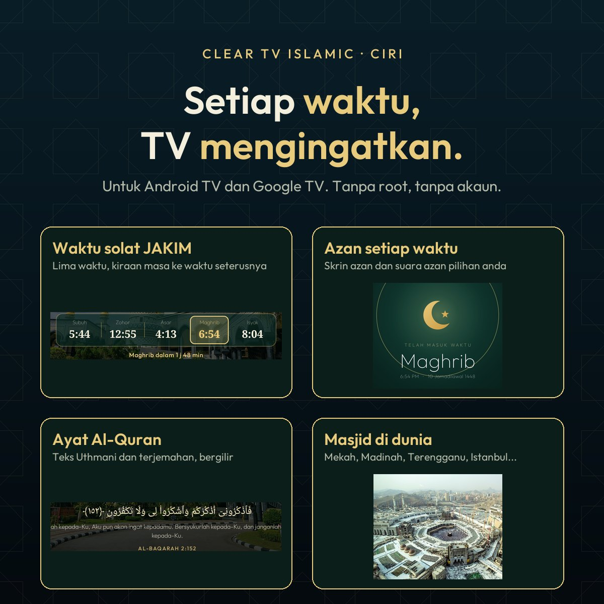
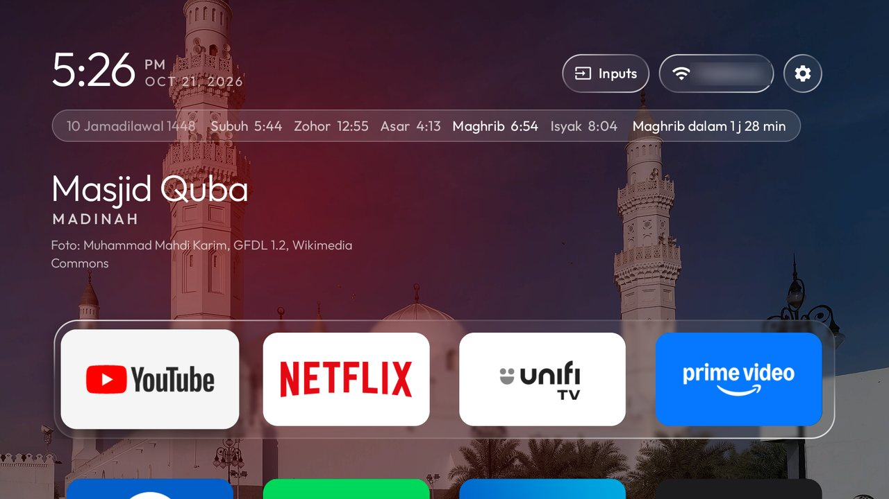
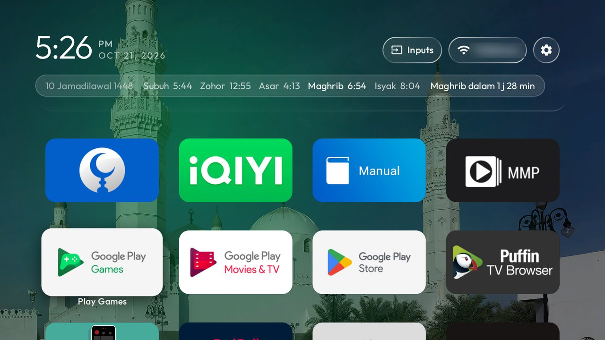
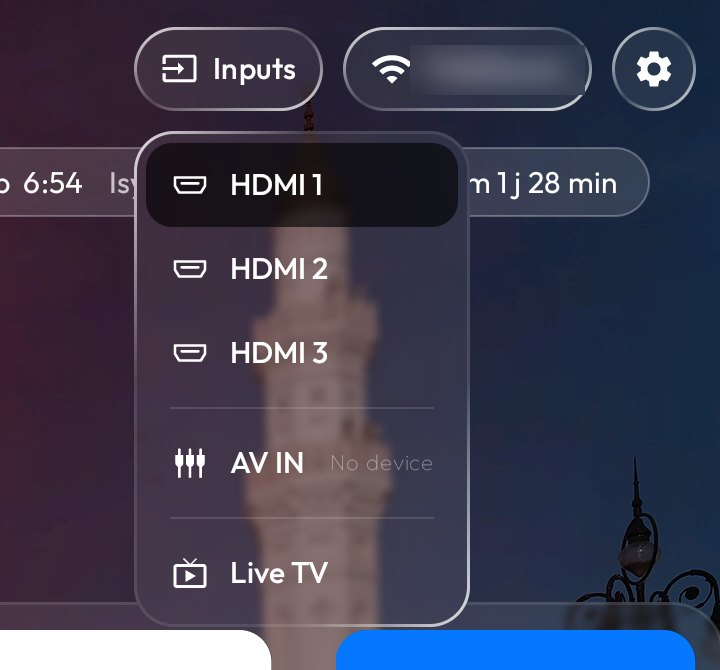
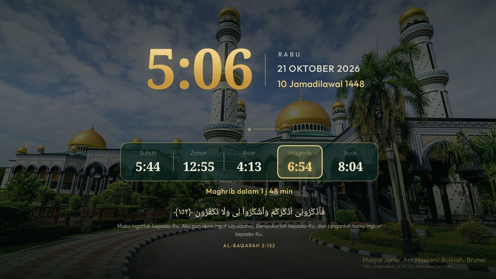
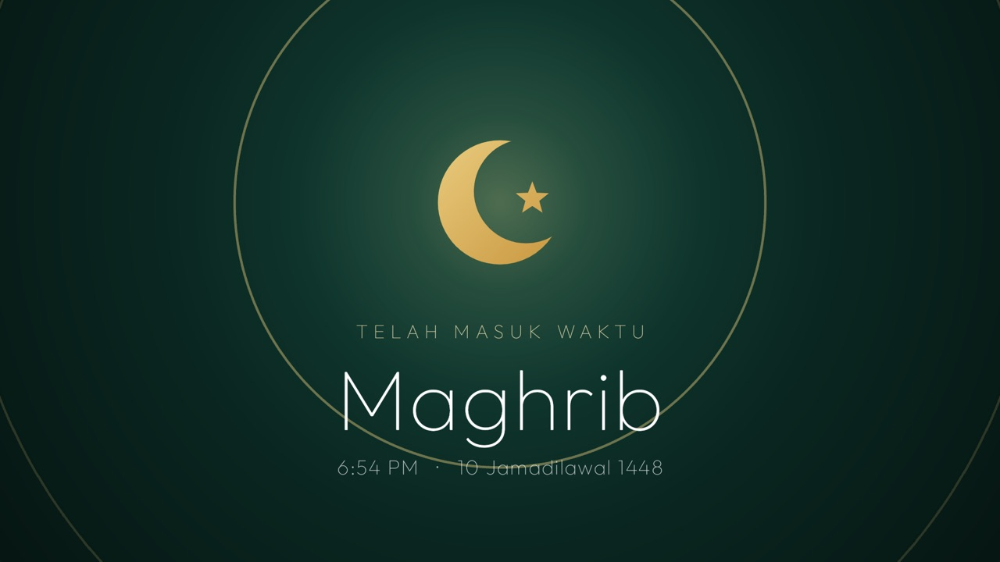
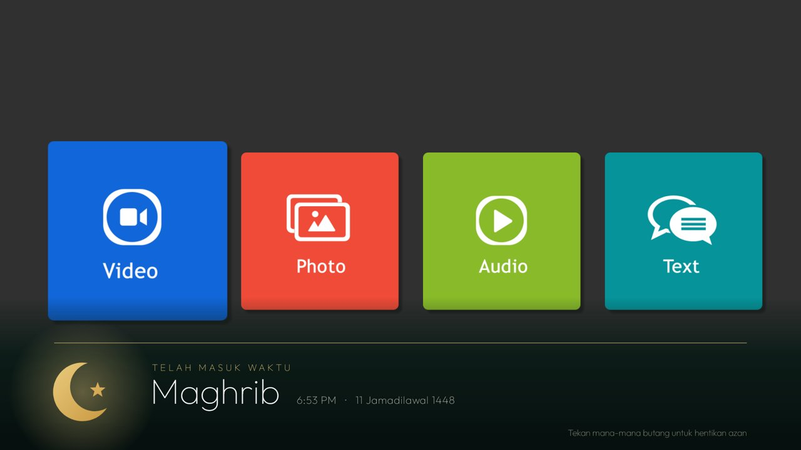

# Clear TV Islamic

<p><a href="README.ms.md">Bahasa Melayu</a> · <b>English</b> · <a href="docs/INSTALL.md">Step-by-step install guide</a> · <a href="docs/INSTALL.ms.md">Panduan pemasangan</a></p>

**Your Android TV or Google TV, fast and ad-free, with JAKIM prayer times, the azan at every prayer, verses of
the Quran, and the world's most beautiful mosques behind your apps, Mecca and Medina among them.**

Clear TV Islamic strips the bloat and ads from your TV over Wi-Fi, with no root and nothing that can't be undone,
then swaps the ad-filled home screen for a light one in frosted glass. Behind your apps: Masjid al-Haram, the
Prophet's Mosque, the Crystal Mosque and many more. Under the clock: today's five prayer times. When the TV
rests: a gold clock, the Hijri date and a verse of the Quran. When the time comes: the azan.

<p>
  
  
  
</p>

- **JAKIM prayer times** for your zone under the clock, with the Hijri date and a countdown to the next prayer.
- **The azan** at every prayer, even while you watch YouTube or Netflix: full screen on Home, a band across the
  bottom over any other app, with the recitation of your choice (a different one for Subuh).
- **An Islamic screensaver**: a gold clock, a card of the day's prayer times and a verse of the Quran that changes.
- **Mosque photos** behind Home and the screensaver: Mecca, Medina, Terengganu, Putrajaya, Istanbul, Brunei...
- **Light and clean**: ads, tracking and bloat switched off, and the TV clears its own caches every 15 days.

**New to this? Follow the [step-by-step install guide](docs/INSTALL.md)**: no coding, no Android SDK, about
30 minutes. Built on [CleanYourTV](https://github.com/Gathin23/cleanyourtv) by Gathin (MIT).

<sub>The promo pictures use photos from Wikimedia Commons: Quba Mosque (Muhammad Mahdi Karim, GFDL 1.2),
Masjid al-Haram (Saudipics.com, CC BY-SA 4.0) and Jame' Asr Hassanil Bolkiah Mosque (Jorge Láscar, CC BY 2.0).</sub>

## What you get

- **Keeps itself clean.** Every 15 days, while Home sits idle, the TV clears its app caches, where the Play
  Store leaves gigabytes of download leftovers that can make apps open to a blank screen. No computer needed,
  sign-ins and app data are never touched; the TV asks once to allow it.
- **Glass, like Apple's.** The dock's tray, the top-bar buttons and the menus show the picture behind them
  softened, with a shine along their edges. Android 10 has no live blur, so the picture is blurred once each
  time it changes and the glass draws its patch of it.
- **One selection that glides.** Between apps it is a pane of glass with the app's shadow under it; on the top
  bar and in the menus it is dark. It glides and changes shape from one to the next, never jumps.
- **Places to visit that renew themselves.** Once a week the TV takes the pictures Bing has shown on its home
  page over the past days — landmarks, landscapes, wildlife — deletes last week's and rotates through them,
  dimmed so the clock and tiles stay readable. The shelf above the dock names each one, its country and a few
  lines about it. Pictures with people in them are skipped: by the words in their caption, and by Android's
  own face detector on the TV. No key, no account, nothing to set up.
- **Every app tints the room.** The glow behind Home, and the glass with it, blends to the colour of whichever
  app is selected.
- **Arrange your apps from the remote.** Hold OK on an app for a glass menu with **Move** and **App info**.
  Move picks the app up: it wiggles, the arrows carry it (into or out of the dock too) and the other apps
  slide aside; OK puts it down. The order is kept, and apps installed later join at the end.
- **An Inputs menu in glass.** The selection glides out of the Inputs button into the list of HDMI and AV
  inputs, and Up from the top of the list glides it back.
- **Comes back as you left it.** Back from an app, the app you left is still selected; pressing Home on Home
  goes to the first app. When Android has closed Home to free memory, it comes back whole in one frame,
  with no black screen and no half-built dock.
- **A clock screensaver.** A grey analog dial with a yellow-orange second hand that ticks, the time and
  date beneath, drifting a little each minute so nothing burns in.
- **Rows feather out under the top bar** instead of being cut off when you scroll, and the Wi-Fi / Ethernet
  button can be hidden (`show_network_pill`).
- **Rotating wallpapers of your own** instead, with `"places": false`: put pictures in a theme's `wallpapers/`
  folder and choose how often they change, down to every 5 seconds. Each picture is decoded in the background
  and cross-faded.

| | |
|---|---|
|  |  |
| *Home, with a mosque and the prayer times* | *Every app, feathering out under the top bar* |
|  |  |
| *Inputs, in glass* | *The Islamic screensaver* |
|  |  |
| *The azan screen at prayer time, on Home* | *The azan over any other app, even YouTube or Netflix* |

Still light: on a Xiaomi Mi TV with 1.8 GB of RAM the launcher uses about 80–100 MB and stays there over hours
of use, one wallpaper is in memory at a time, the week's places take about 2 MB of storage, and nothing runs
while you are inside an app, except the azan at prayer time.

## Setting it up

**The easy way, with no coding:** the [step-by-step install guide](docs/INSTALL.md) installs the ready-made
`dist/clear-tv-islamic.apk`, so you need only Python, not Java or the Android SDK.

**Using an AI coding agent** (Claude Code, Codex, Cursor, Copilot…)? Point it at this repository and ask it to
set up your TV. [AGENTS.md](AGENTS.md) tells any agent, even a small model, how to do it safely on any Android TV or Google
TV: it first works out which Clear TV Islamic your TV can run (the Android launcher, the LG webOS app, or neither on
Samsung and Roku), then
asks before each change, backs up first, never uninstalls, and checks each step with you as it goes.

The full step-by-step guide for debloating and installing is in
[docs/CLEANYOURTV-README.md](docs/CLEANYOURTV-README.md), and [PROMPT.md](PROMPT.md) lets a coding assistant do
it for you. In short:

```bash
python3 -m venv tools/venv && tools/venv/bin/pip install -r tools/requirements.txt
export TV_HOST=192.168.1.50                                   # your TV's IP address
tools/disable.sh examples/<your tv>/debloat.txt               # debloat
launcher/build-and-install.sh                                 # build the launcher and make it Home
# or, without building: APK=dist/clear-tv-islamic.apk launcher/build-and-install.sh
tools/theme.sh themes/<your theme>                            # push your settings and wallpapers
```

Clear TV Islamic clears the TV's caches by itself every 15 days ([how](docs/cache-clean.md)). To clean several TVs
from one computer instead, [`tools/cache-clean.sh`](docs/cache-clean.md) finds the TVs on your network and
clears their caches, leaving sign-ins and app data untouched.

## Prayer times and azan


- **Prayer times on Home:** a glass row under the clock with the Hijri date, today's five prayers (Subuh, Zohor,
  Asar, Maghrib, Isyak), the next one highlighted and a countdown ("Asar dalam 12 min"). The whole year's times
  are fetched once from [JAKIM e-Solat](https://www.e-solat.gov.my) and kept on the TV.
- **The Islamic screensaver:** a gold clock, the Malay and Hijri dates, a card of the prayer times with the next
  one framed in gold, and a verse of the Quran with its translation that changes every 3 minutes. Arabic text in
  the Uthmani script and the translation of the Indonesian Ministry of Religious Affairs (Kemenag RI), via
  quran.com (`launcher/app/src/main/res/raw/ayat.json`).
- **Mosque photos:** Masjid al-Haram, the Kaaba, the Prophet's Mosque, Quba Mosque and other beautiful mosques
  (the Crystal Mosque, Putra Mosque, Istanbul, Brunei, Lahore, Jerusalem...) behind the screensaver, changing
  with the verse, and behind Home in place of the weekly places, each named with its photographer's credit. All
  from Wikimedia Commons under free licences; the list is [themes/islamik/masjid.json](themes/islamik/masjid.json)
  and `python3 tools/masjid-photos.py <theme folder>` downloads them. `"masjid_home": false` brings the weekly
  places back to Home.
- **The azan:** at every prayer time, on the screensaver or on Home, the azan screen comes up and `azan.mp3` plays
  (`azan-subuh.mp3` for Subuh). **In any other app** (YouTube, Netflix, Live TV) a band slides up across the lower
  third of the screen with the prayer's name, the video underneath pauses and the azan plays. Any button on the
  remote stops it. `"azan_over_apps": false` keeps the azan to Home and the screensaver.

**How:** install as usual, then make a theme folder with a `config.json`
([themes/islamik](themes/islamik/config.json) is ready to copy):

```json
{
  "prayer_zone": "TRG04",
  "azan": true
}
```

Change `TRG04` to your JAKIM zone (for example `WLY01` Kuala Lumpur, `SGR01` Petaling and Gombak, `JHR02` Johor
Bahru; the full list is on the e-Solat site). [themes/islamik](themes/islamik) comes with an azan (`azan.mp3`, by
Ustaz Asri Ibrahim of Rabbani) and a Subuh azan (`azan-subuh.mp3`); replace either with a recording of your own,
keeping the name. Then send it to the TV:

```bash
python3 tools/masjid-photos.py <theme folder>      # mosque photos (optional)
TV_HOST=<tv ip> tools/theme.sh <theme folder>
```

Without an audio file the azan screen shows silently for 90 seconds. `"azan": false` turns the azan off;
removing `prayer_zone` turns all of it off.

## Which TVs work

Android TV and Google TV, Android 8 or newer, on the TV or on a box plugged into any TV.
[docs/DEVICES.md](docs/DEVICES.md) lists every tested model and how far each was tested: end to end with
Clear TV Islamic, with the original launcher, or debloat only, plus what is expected to work and what cannot.

## LG and Samsung TVs

LG TVs run webOS and Samsung TVs run Tizen; neither can run Android apps, and neither lets any app replace its
home screen or the Home button. For the full Clear TV Islamic, plug in a Google TV or Android TV box (Chromecast with
Google TV, Xiaomi Mi Box, NVIDIA Shield): the TV becomes the screen and Clear TV Islamic is Home. On LG, a version you
open as an app is in preview in [webos/](webos/README.md).

## Places, or pictures of your own

Places are on from the start. To change how often the picture changes, or to use your own pictures and keep
the launcher offline, make a theme folder with a `config.json` like this and push it with `tools/theme.sh`:

```json
{
  "places": false,
  "wallpaper_seconds": 15,
  "show_network_pill": false
}
```

All keys are listed in [themes/README.md](themes/README.md). With `"places": false`, the launcher never goes
online.

## Credits and licence

- Built on [CleanYourTV](https://github.com/Gathin23/cleanyourtv) © 2026 Gathin, MIT licence — see
  [LICENSE](LICENSE). Its debloat lists, tools and launcher are the foundation of this project.
- The Outfit typeface is under the SIL Open Font License (`launcher/FONT-LICENSE-OFL.txt`).
- The Inputs icon is from Google's Material Icons (Apache 2.0).
- Pictures of places and their captions are Bing's daily images (Microsoft). The launcher fetches them on your
  own TV; the promo pictures above show three of them.
- Gotham, used in the original promo pictures only, is a Hoefler&Co. typeface and is not part of this repository.
- Prayer times from JAKIM's [e-Solat](https://www.e-solat.gov.my). Quran text (Uthmani, Hafs) and the Kemenag RI
  translation via [quran.com](https://quran.com). Mosque photos from Wikimedia Commons, each credited on screen and
  in [themes/islamik/masjid.json](themes/islamik/masjid.json).
- The azan recordings in [themes/islamik](themes/islamik): Ustaz Asri Ibrahim (Rabbani), and "Adzan Subuh Merdu".
  The repository owner states they are free to share; a rights holder who disagrees can open an issue and they
  will be removed.
